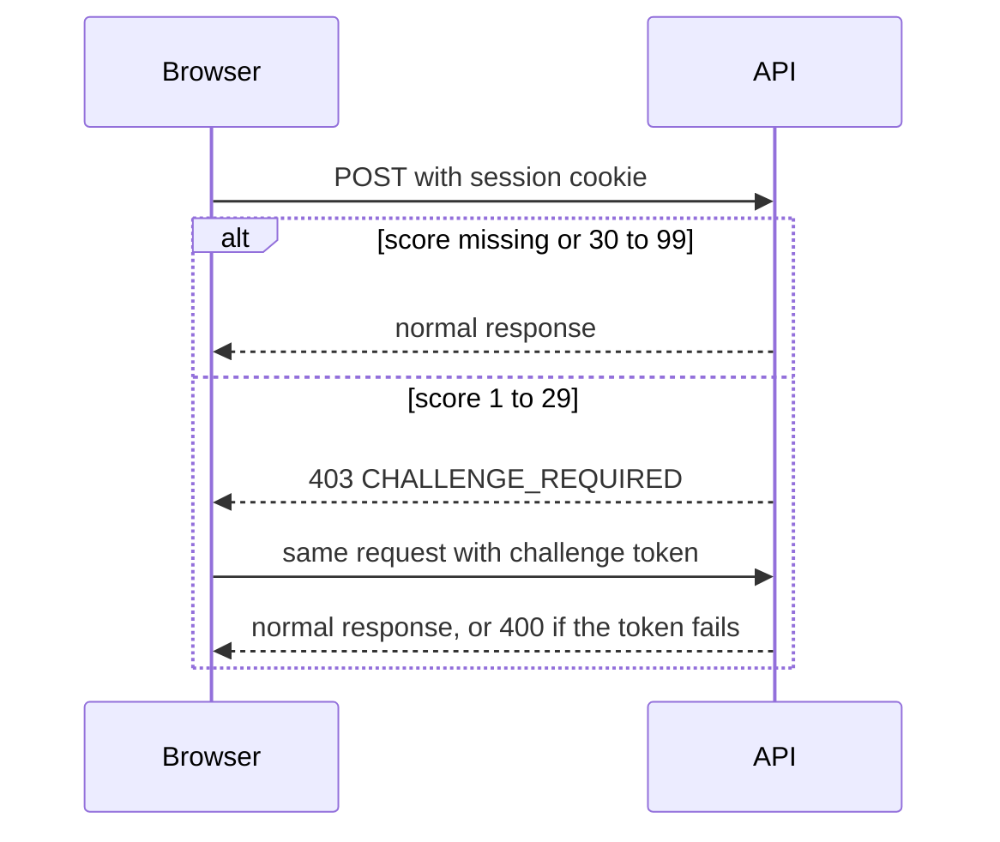

# Description examples

Each example shows where the conclusion sits and what is folded away. Use the repository's own
headings. Do not copy a claim or a figure the current change does not support.

## Small fix: prose only

```markdown
## Problem

Reopening the review dialog lost the new selection. A reset timer started on close kept running
and cleared it.

## Change

Reopening the dialog cancels the pending reset. Closing still clears the old selection after the
exit animation.
```

No table, diagram, or list of passing tests.

## Behavior change that is not active yet

````markdown
## Problem

The plan limit applies only to the agent API. A script holding a copied session cookie can do
through the REST API what the agent API refuses.

## Change

Writes from sessions the edge flags as likely automated must pass a challenge first. The web app
shows the challenge and retries the request.

| Request                              | Before  | After                                    |
| ------------------------------------ | ------- | ---------------------------------------- |
| Cookie-session write, score 30 to 99 | Allowed | Allowed, unchanged                       |
| Cookie-session write, score 1 to 29  | Allowed | `403 CHALLENGE_REQUIRED`, then one retry |
| Any read                             | Allowed | Allowed, never challenged                |
| API-key request                      | Allowed | Allowed, unchanged                       |
| No score supplied                    | Allowed | Allowed; the check is skipped            |



## Impact

**Not active yet.** The score comes from a paid edge plan, and the check is skipped without it.
It turns on with no code change once the score is supplied.

- Flagged users see a short challenge before each write.
- Scripts with a copied cookie fail on writes.
- Limitation: automation driving a real browser can pass the challenge.
````

The table includes the unchanged cases a reviewer would worry about, and the impact opens with
when the change takes effect.

## Schema change

```markdown
## Change

Recovery attempts now reference a retained account identity through a foreign key. Before, an
unvalidated identifier could point at an account that no longer existed.

## Impact

Deleting an account can no longer orphan its recovery history. The recovery API response is
unchanged. Storage cost is unmeasured; it grows by one identity row per deleted account.

<details>
<summary>Schema inventory</summary>

| Object                                 | Before            | After                     |
| -------------------------------------- | ----------------- | ------------------------- |
| `account_identity` table               | Absent            | One row per account, kept |
| `recovery_attempt.account_id`          | Unvalidated UUID  | Removed                   |
| `recovery_attempt.account_identity_id` | Absent            | Required foreign key      |
| Lookup index                           | On the old column | On `account_identity_id`  |

The writer, the deletion path, and the operator query change in this pull request. Nothing reads
or writes both columns.

</details>
```

## Workflow change with a cost estimate

```markdown
## Change

Test jobs run once per commit. Before, marking a draft ready started a second run of the same
tests on the same commit.

## Impact

Checks already attached to a commit stay when the pull request is marked ready. Estimated: one
12-minute suite saved per draft-to-ready transition. Total savings are unmeasured.
```

## CI caught what a local check missed

```markdown
## Local check gap

CI failed in the compiler-contract job on the first pushed commit (link to the run): a public
export was missing. The pre-push command ran the component project only and did not include the
compiler-contract project. That project is now part of the pre-push command, and a test imports
the export through the public entry point.
```

When the same suite passed locally and failed in CI, say what differed, such as the build target
or a fixture, and what now makes the local run match.
